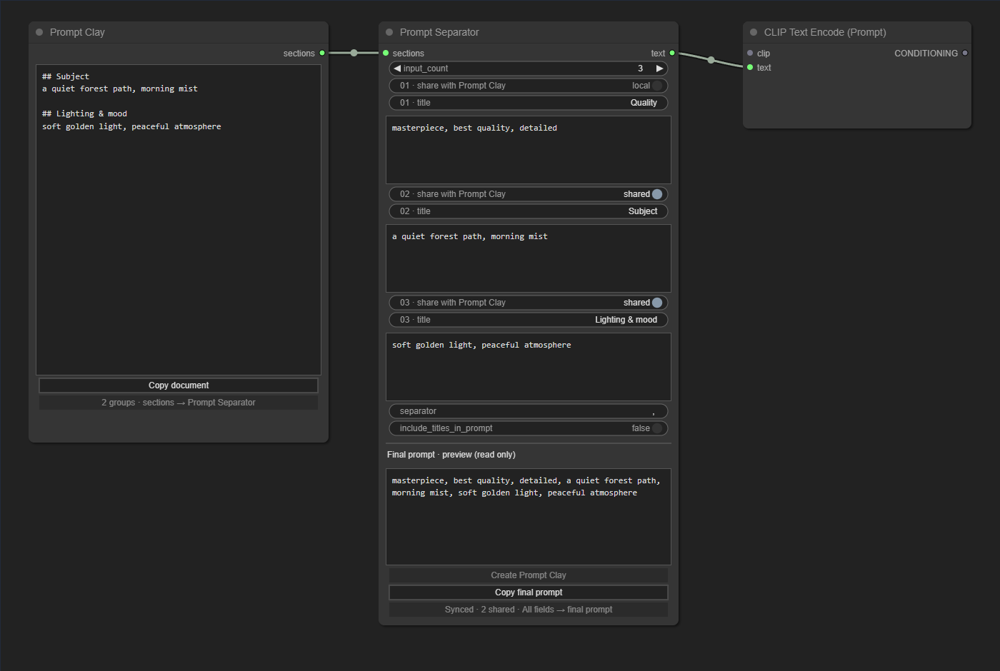
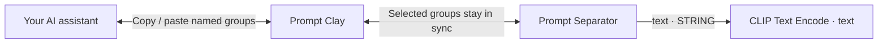

<div align="center">

# Node Perfector

**Shape the idea. Keep every detail.**

A growing collection of custom nodes for ComfyUI.<br>
Starting with a better way to write, refine, and assemble prompts.


[The nodes](#the-nodes) · [Installation](#installation) · [Workflow](#workflow) · [Development](#development)

</div>

---

Prompts become hard to manage when quality tags, subjects, style, lighting, and small details live in one long text box. Giving that same text to an AI assistant makes it easy to change the wrong part.

**Node Perfector gives the same prompt two useful views:** named sections for working with AI, and separate fields for precise manual editing. One clean output goes to your text encoder.



<sub>Native LiteGraph canvas and controls in the browser test harness, with a substitute for ComfyUI's standard multiline-textarea host. Runtime uses ComfyUI's own widgets and theme. The example contains generic sample text only.</sub>

## The nodes

### Prompt Clay

**A structured document for shaping prompts with AI.**

See your editable prompt as one document with clearly named groups. Copy it into an AI assistant, ask for changes to specific groups, and paste the revised document back. The connected Prompt Separator updates immediately.

```text
## Subject
a quiet forest path, morning mist

## Lighting & mood
soft golden light, peaceful atmosphere
```

- Group names keep the subject, style, lighting, and other details easy to distinguish.
- Each `## Heading` starts a group; the text below it is that group's content.
- Add, rename, reorder, or remove groups directly in the document.
- Only fields selected in Prompt Separator appear here.
- Copy the whole document with one button.

Prompt Clay is an editor, so it does not call an AI service itself. You choose where to use the document.

### Prompt Separator

**Separate fields for careful edits. One final prompt for generation.**

Set the number of fields at the top, give them optional titles, and edit each piece independently. Choose a separator below the fields and see the exact assembled text in the live preview.

- **1–64 fields**, each with its own title and multiline text.
- A switch beside each field chooses whether its title and text appear in Prompt Clay.
- Live synchronization in both directions for shared fields.
- A custom separator: a comma, space, line break, or any other text.
- Optional titles in the final prompt; off by default.
- The final preview has a divider and a **read only** heading to distinguish it from editable fields.
- Empty fields are skipped when joining text.
- Reducing the field count temporarily stores the removed fields; increasing it brings them back.
- **Create Prompt Clay** makes and connects a matching editor from the selected fields.
- The `text` output is a standard ComfyUI `STRING`.

Both nodes use native ComfyUI widgets and the standard `ComfyWidgets.STRING` multiline editor. A small canvas divider labels the final preview using LiteGraph's theme colors. There is no separate HTML panel, custom stylesheet, or replacement node theme.

### One switch, one clear purpose

The switch controls **what appears in Prompt Clay**, including both the title and the content. It does not disable a field in the final prompt.

| Field | Shared with Prompt Clay | Included in final prompt |
|:--|:--:|:--:|
| Quality tags, switch off | No | Yes |
| Subject, switch on | Yes | Yes |
| Lighting, switch on | Yes | Yes |
| Empty field | According to its switch | Skipped |

This lets you keep fixed quality tags or personal details under manual control while asking AI to rewrite the subject and atmosphere. Excluded fields stay in Prompt Separator and still contribute to generation.

## Installation

Works with a local ComfyUI installation, including Windows Portable and Desktop installations that load custom nodes. No extra Python libraries, models, API keys, or JavaScript build step are needed.

1. Extract the release archive, or copy this repository, into your active ComfyUI `custom_nodes` directory.
2. Check the folder structure:

   ```text
   ComfyUI/
   └── custom_nodes/
       └── node-perfector/
           ├── __init__.py
           ├── nodes.py
           ├── prompt_core.py
           └── web/
   ```

3. Restart ComfyUI, then refresh the page with **Ctrl+F5**.
4. Search for **Prompt Separator** and **Prompt Clay**, or open **Node Perfector → Prompt** in the node menu.

Use the user-data `custom_nodes` directory for ComfyUI Desktop, rather than the application's bundled program files. This project has not been published to ComfyUI Manager yet.

To update a Git installation, run `git pull` inside the `node-perfector` folder, restart ComfyUI, and refresh with **Ctrl+F5**. For ZIP installations, replace the plugin files with the latest archive. See the [changelog](CHANGELOG.md) for fixes.

## Workflow



1. Add **Prompt Separator** and arrange your prompt into named fields.
2. Turn off the switches for fields you want to keep out of the AI editing document.
3. Click **Create Prompt Clay** to create a connected editor containing the selected fields.
4. Copy the document from Prompt Clay into your preferred AI assistant. For example:

   > Refine the Subject and Lighting & mood groups. Preserve the `## Heading` structure and return the full edited document without code fences.

5. Paste the result back into Prompt Clay. The shared fields and final preview update immediately; excluded fields keep their contents.
6. Connect **Prompt Separator → text** to **CLIP Text Encode → text**.

If CLIP Text Encode only shows a text box, right-click the node and select **Convert text to input** (or **Convert widget to input → text**, depending on the frontend version). Then connect the `text` socket. The `clip` socket receives the CLIP model from your checkpoint or CLIP loader; it is a different data type.

Already have both nodes? Connect **Prompt Clay → sections** to **Prompt Separator → sections**. On connection, Clay supplies the shared groups. Use the create button when you want to seed Clay from existing fields.

You can also open [`examples/prompt-editing.json`](examples/prompt-editing.json) in ComfyUI. It includes both nodes and a connected CLIP Text Encode. Connect your model's CLIP output and continue with your normal generation workflow; the example does not include a model or sampler.

### Text rules

- Shared groups match the selected fields **in their document order**, rather than by title. Renaming a group is safe; repeating a title is allowed. Reordering document groups reorders the shared content; excluded fields retain their places among those fields. Extra groups are appended, and removing groups removes the corresponding shared fields.
- Excluded fields are kept locally and merged with Clay's groups during execution as well as in the live preview. This also works when running a saved workflow through ComfyUI's API.
- Clearing the entire Clay document removes shared content. Excluded fields remain. Prompt Separator always keeps at least one editable field.
- The final prompt strips outer whitespace from each text field, skips empty text, and joins the rest with the selected separator. It does not remove duplicate tags or punctuation.
- Type `\n` for a line break or `\t` for a tab in the separator. Use `\\` for a literal backslash. Unicode separators work too.
- A body line that should literally start with `## ` can be escaped as `\## `. A literal leading backslash can be escaped as `\\`. These escapes are handled automatically when sending fields to Clay.
- The combined number of shared and excluded fields cannot exceed 64. An oversized document shows an error instead of silently truncating content.
- Titles are organizational by default. They enter the final prompt only when **include_titles_in_prompt** is enabled.
- Text is passed through without expanding wildcards or random-choice syntax.

## Local by default

The nodes make no outbound network requests, contain no analytics, and require no account or API key. Copy buttons use your local clipboard only when pressed.

Prompt content is saved in your ComfyUI workflow and may also appear in image metadata when ComfyUI embeds the workflow. Check your workflow and image metadata before sharing your own generations. This repository's sample workflow and preview contain generic forest-scene text only.

## Troubleshooting

| Symptom | What to check |
|:--|:--|
| Nodes do not appear | Restart ComfyUI; check that `__init__.py` is directly inside `custom_nodes/node-perfector`, with no extra nested folder. |
| A raw `state` field appears | The frontend extension did not load. Refresh with Ctrl+F5 and check that the `web` directory was copied too. |
| Cannot connect to CLIP | Connect the `STRING` output to `text`, converting that text widget to an input if necessary. |
| A field is missing from Clay | Enable its **share with Prompt Clay** switch. It remains part of the final prompt either way. |
| Text changed when manually connecting Clay | Clay is the source of shared groups when connected. Use **Create Prompt Clay** to start with the existing field values. |
| The document is rejected | Use at most 64 total fields, including excluded fields in the connected Separator. |

## Development

Runtime code uses Python's standard library and plain browser JavaScript. Node.js is only needed for frontend development tests.

```text
__init__.py          ComfyUI entry point and frontend directory
nodes.py             Node definitions and registrations
prompt_core.py       Parsing, joining, and selective merge logic
web/                 Node controls and matching browser text rules
examples/            A ready-to-open ComfyUI workflow
tests/               Shared fixtures, Python checks, browser integration tests
scripts/             Release packaging and privacy checks
```

Add future nodes to `NODE_CLASS_MAPPINGS` and `NODE_DISPLAY_NAME_MAPPINGS` in `nodes.py`. Keep the `Perfector` prefix on their internal identifiers to avoid collisions with other packs. Larger additions can live in separate modules and be imported into that registration file.

Run checks from the repository root:

```bash
python -m unittest discover -s tests -p "test_*.py" -v
npm ci
npx playwright install chromium
npm test
python scripts/build_release.py
```

On Windows, use `py` instead of `python` if needed. The browser suite uses the real LiteGraph canvas, native controls, graph, links, node loading, and workflow serialization, with a small substitute for ComfyUI's multiline-textarea host. It covers editing, native toggle clicks, preservation of excluded fields, errors, count restoration, save/reload, and late execution results. It does not run an image model or replace a final check in your own ComfyUI version.

The optional `tests/comfy.spec.js` suite checks real ComfyUI widget callbacks, workflow export/reload, and backend text execution. Set `COMFYUI_TEST_URL` to an isolated test server and run `npm run test:browser -- tests/comfy.spec.js`. Use a temporary ComfyUI user directory: these tests replace the open test workflow. Version 1.0.1 was checked with ComfyUI 0.43.2 and frontend versions 1.45.21 and 1.57.4; these checks require no model weights.

## Publish your own repository

1. Create an empty GitHub repository named `node-perfector`. Leave README, license, and `.gitignore` unchecked because this project already includes them.
2. For commit privacy, enable **Keep my email addresses private** in GitHub's email settings and copy your GitHub-provided `noreply` address. Set your commit identity for this repository using your public GitHub handle and that address.
3. Run these commands from this project folder, replacing the uppercase placeholders:

   ```bash
   git init -b main
   git config user.name "YOUR_GITHUB_HANDLE"
   git config user.email "YOUR_GITHUB_NOREPLY_EMAIL"
   git add .
   git diff --cached --stat
   git diff --cached --check
   git commit -m "Add Prompt Separator and Prompt Clay"
   git remote add origin https://github.com/YOUR_GITHUB_HANDLE/node-perfector.git
   git push -u origin main
   ```

4. Authenticate through Git's browser sign-in when prompted. Do not put tokens in the remote URL or in project files.

Reference: [GitHub's guide to publishing a local project](https://docs.github.com/en/migrations/importing-source-code/using-the-command-line-to-import-source-code/adding-locally-hosted-code-to-github) and [commit email privacy](https://docs.github.com/en/account-and-profile/concepts/email-addresses).

The included `.gitignore` excludes local dependencies, test output, caches, release archives, editor settings, `.env` files, and common credential files. Review the staged files before publishing. The release builder also scans the distributable text for personal paths and common secret formats.

## License

[MIT](LICENSE)

---

<div align="center"><sub>Clear groups for AI. Precise fields for you. One prompt for generation.</sub></div>
